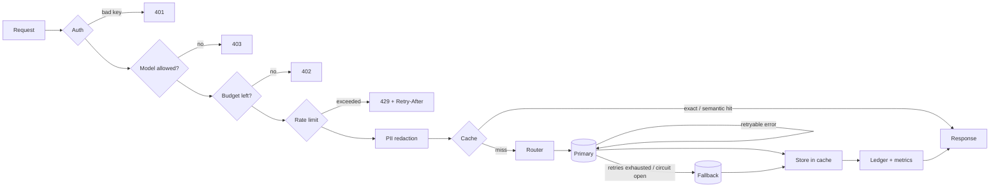

# Relay: a production-grade LLM gateway

Relay sits between your applications and LLM providers. It exposes an **OpenAI-compatible API**, so any OpenAI SDK can point at it unchanged, and it adds the reliability, cost-control and governance layer that production AI systems need but individual apps shouldn't each have to rebuild.

```
 apps / SDKs ──►  Relay  ──►  Anthropic · OpenAI · vLLM / Ollama · …
                   │
                   ├─ auth, per-tenant model allow-lists
                   ├─ monthly budgets (402) + token-bucket rate limits (429)
                   ├─ PII redaction before anything leaves the network
                   ├─ exact + semantic response cache
                   ├─ routing: retries w/ jittered backoff → fallback chain → circuit breakers
                   ├─ SSE streaming with pre-first-token failover
                   └─ SQLite usage ledger, cost reports, Prometheus metrics
```

## Request pipeline



## Quick start

```bash
make install          # venv + deps
make test             # 38 tests, < 1s
make run              # gateway on :8080, mock providers, no API keys needed
```

```bash
curl localhost:8080/v1/chat/completions \
  -H "Authorization: Bearer relay-dev-acme" -H "content-type: application/json" \
  -d '{"model": "default", "messages": [{"role": "user", "content": "Explain the CAP theorem"}]}' -i
```

Every response says what happened to it:

```
x-request-id:     63b739f3…
x-relay-provider: mock-backup     # which upstream produced the answer
x-relay-model:    mock-small
x-relay-cache:    miss            # miss | exact | semantic | bypass
x-relay-attempts: 3               # >1 means retries or fallback happened
```

Use real models by exporting a key; the `claude` route then serves from Anthropic and only falls back to the mock if Anthropic is unhealthy:

```bash
export ANTHROPIC_API_KEY=sk-ant-...
make run
```

```python
from openai import OpenAI
client = OpenAI(base_url="http://localhost:8080/v1", api_key="relay-dev-acme")
client.chat.completions.create(model="claude", messages=[{"role": "user", "content": "hi"}])
```

## API

| Endpoint | Purpose |
|---|---|
| `POST /v1/chat/completions` | OpenAI-compatible chat, with `stream: true` for SSE |
| `GET /v1/models` | Routes this key may use |
| `GET /v1/usage` | Month-to-date spend, tokens, cache hit rate and savings, broken down by model |
| `GET /admin/providers` | Provider availability and circuit-breaker state (admin keys only) |
| `GET /metrics` | Prometheus exposition |
| `GET /healthz` | Liveness |

`model` is either a **route alias** from `config.yaml` (`default`, `claude`, `local`) or a direct `provider/model` reference such as `anthropic/claude-haiku-5-5`.

## Design decisions

**Retries vs. fallback vs. circuit breaking are separate concerns.**
Retryable errors (408/409/425/429/5xx and transport failures) are retried with *full-jitter* exponential backoff so a fleet of clients doesn't retry in lockstep. Once retries are exhausted the router moves to the next target in the route's fallback chain. Each provider has a circuit breaker (closed → open → half-open with a single probe), so a dead upstream is skipped instantly instead of costing every request a timeout. Non-retryable errors (e.g. 400) skip straight to fallback but *don't* count against the breaker: the upstream answered, so it's healthy and the request is the problem. A half-open probe that never reports back, for example because the client hung up, expires so it can't wedge the breaker.

**Streaming failover only before the first token.**
Fallback is possible until the first event arrives. After that the client has already rendered output, so a mid-stream failure is reported as an SSE error event rather than silently spliced with another model's output. Usage is accounted in a `finally` block, so streams that error or disconnect are still billed.

**Token rate limits are charged after the fact.**
Request count is charged up front. Token usage isn't known until the response completes, so it is charged afterwards and the bucket may go into *debt*. A tenant in debt is blocked until the bucket refills. This is exact without needing to predict output length.

**The semantic cache is partitioned and verified.**
Exact tier: SHA-256 of `(model, max_tokens, conversation)`. Semantic tier: entries are partitioned by `(model, max_tokens, all messages but the last)`, and only the final user turn is compared by cosine similarity. A near-duplicate question is reused only when the conversation leading up to it is identical. Requests with `temperature > 0` bypass the cache, because the caller asked for variety.

During load testing the semantic tier **served wrong answers**: `"top 10 risks…"` and `"top 5 risks…"` score 0.92 cosine similarity. That's a known failure mode of embedding caches in general, not just of this embedder. The fix: a semantic hit also requires the two prompts to contain exactly the same numbers. The bug is pinned by `test_semantic_cache_never_matches_prompts_with_different_numbers`.

**The default embedder is lexical, and the code says so.**
`HashingEmbedder` (signed feature hashing over words, bigrams and character trigrams) has zero dependencies and catches casing, punctuation and spacing variants. It cannot tell *"capital of France"* from *"capital of Germany"* (0.76) any better than from a true paraphrase (0.77), which is why the threshold sits at 0.9. For real paraphrase matching, set `cache.embedder.type: openai` to use any `/embeddings` endpoint (OpenAI, Ollama, TEI, vLLM).

**PII is redacted before the cache and before the upstream.**
Emails, phone numbers, SSNs, IPv4 addresses and Luhn-validated card numbers are replaced with `[EMAIL]`, `[CREDIT_CARD]`, etc. Cache keys are computed on the redacted text, so the cache never stores raw PII either.

**The core is HTTP-agnostic.**
`relay/gateway.py` holds the whole pipeline and knows nothing about FastAPI, and `relay/app.py` is a thin translation layer. Providers implement a two-method interface (`complete`, `stream`), so adding a provider means adding one adapter file.

## Benchmark

`make loadtest`: 3,000 requests at concurrency 50 against mock upstreams (40 ms latency, **15% injected failure rate**) on a laptop:

```
requests     3000 in 2.08s  (1443 req/s)
latency ms   p50=30.7  p95=59.3  p99=149.9
status       {'200': 3000}
cache        {'miss': 364, 'semantic': 874, 'exact': 1762}
spend        $0.1143  saved by cache $0.8305

relay_upstream_calls_total{provider="mock-primary",outcome="error"} 62
relay_degraded_requests_total{route="default"} 51
```

Despite 62 injected upstream failures, **every request succeeded**: retries absorbed most of them and one request fell back to the backup provider. These figures measure the gateway's own overhead and behaviour against a simulated upstream. They are not end-to-end LLM latencies.

## Project layout

```
relay/
  app.py              FastAPI layer: OpenAI-compatible endpoints, SSE
  gateway.py          the request pipeline (admission → cache → route → account)
  routing.py          route resolution, retries, fallback, streaming failover
  circuit_breaker.py  per-provider breaker
  ratelimit.py        token buckets (requests + LLM tokens, with debt)
  cache.py            exact + semantic cache, LRU/TTL, numeric guard
  embeddings.py       hashing embedder, OpenAI-compatible embedder
  guardrails.py       PII redaction
  ledger.py           SQLite usage ledger, budgets, reports
  metrics.py          dependency-free Prometheus metrics
  providers/          anthropic, openai-compatible, mock
tests/                unit tests per component + end-to-end API tests
scripts/loadtest.py   concurrent load generator
```

## Limitations and next steps

- **Single replica.** Rate-limit buckets, breaker state and the cache live in process memory. Scaling out means moving buckets to Redis (atomic Lua token bucket), the cache to Redis or a vector store, and the ledger to Postgres.
- **No request coalescing.** Identical prompts that arrive concurrently each miss the cache and each call upstream. A single-flight map keyed on the cache key would collapse them into one call.
- **The semantic scan is linear** within a partition. That's fine for thousands of entries; an ANN index (HNSW) would be needed beyond that.
- **Pricing in `config.yaml` is illustrative.** Copy current per-token rates from each provider before trusting cost reports.
- Tool calling and multimodal content aren't proxied yet. Messages are text-only.
- API keys are stored in plaintext config. Production would store hashes and load them from a secret manager.
